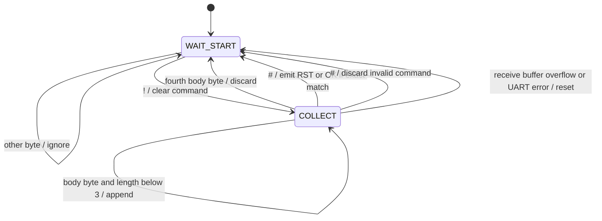
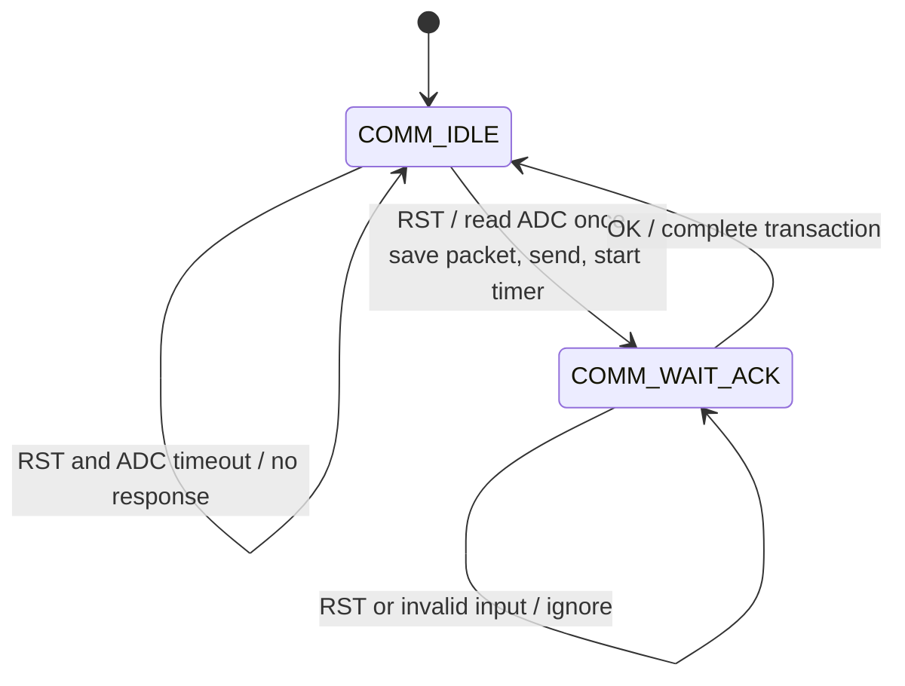

# Lab 5 - Flow and Error Control in Communication

STM32F103C6, STM32 HAL, HSI 8 MHz. USART2 uses PA2/TX and PA3/RX,
9600 baud, 8N1, no flow control. PA0 is ADC1_IN0 in continuous mode;
PA5 toggles every 500 ms. Existing generated TIM2 configuration is retained
but is not started or used by this application. No scheduler is needed.

## FSM design

The parser emits one command event at each valid closing `#`. The main loop
passes that event to the communication FSM immediately, so consecutive frames
do not overwrite a single shared command flag.





Sending is a transition action, not an additional persistent state. A short
blocking HAL transmit runs only in the main loop; ACK waiting never blocks.
The timer starts after each transmit attempt returns. A failed UART transmit
is retried with the same stored packet after 3000 ms.

## Protocol and data flow

1. USART2 IRQ calls `HAL_UART_IRQHandler(&huart2)`.
2. The receive callback copies one byte to a 30-byte ring buffer and rearms RX.
3. Main removes bytes with interrupts disabled only for a short buffer access.
4. `command_parser_fsm()` recognizes `!RST#` and `!OK#` without Enter.
5. In idle, RST reads one completed ADC conversion and sends `!ADC=<value>#`.
6. Until OK, the saved packet is resent every 3000 ms without reading ADC again.
7. After OK, another RST samples a new value. An OK while idle is ignored.

The ring has 29 usable slots (one slot distinguishes full from empty). Overflow
or a UART receive error discards queued input and resets the partial command,
preventing a damaged frame from being assembled across lost bytes. Send a fresh
`!RST#` after such an error. Normal consecutive commands are processed in order.
No finite buffer can retain unlimited input while processing is blocked.

All elapsed-time checks use unsigned subtraction and work across tick rollover.
There are no final-protocol banners, echoes, spaces, CR/LF, or continuous ADC logs.

Manual corrections: Section 6.1 says RTS, but Section 6 specifies `!RST#`;
this project implements RST. The STM32F103 ADC is 12-bit (0-4095), not 13-bit.
With VDDA = 3.3 V, approximately 1.65 V gives 2048; 5 V must not be used as the
ADC full-scale voltage. The existing Proteus potentiometer is labelled RV1
rather than RV2; it is the same 1 kOhm sensor control, with a 10 kOhm follower
feedback resistor. Existing peripheral configuration is otherwise preserved.

## Build and intermediate exercises

Run from `LAB_5/Lab5_UART` in PowerShell, with CMake, Ninja and ARM GCC on PATH:

Open `Lab5_UART.ioc` in CubeMX; it replaces the copied `Lab4_Scheduler.ioc` name.
Its project metadata and generated initialization list now identify Lab 5/USART2.

```powershell
cmake -S . -B build -G Ninja "-DCMAKE_TOOLCHAIN_FILE=arm-gcc-toolchain.cmake" -DLAB5_MODE=0 -DLAB5_ADC_CALIBRATION=OFF
cmake --build build
```

The supplied toolchain file uses the existing installed ARM GCC path. Output:
`build/Lab5_UART.elf`, `build/Lab5_UART.hex`, `build/Lab5_UART.bin`.
The Makefile also includes both FSM modules; its default is `LAB5_MODE=0`.

### ADC calibration and Proteus

The user reported that the first protocol firmware, with ADC calibration enabled,
did not blink the LED or respond. Calibration failure enters `Error_Handler()`
before UART reception starts. The current `build` cache is therefore configured
with `LAB5_ADC_CALIBRATION=OFF`. With this setting, the user confirmed LED
blinking, ADC responses, unchanged retries after moving the potentiometer,
ACK stopping retries, and a new value on a later request. ADC conversion and
the protocol are unchanged. This isolates the observed startup failure to the
calibration-enabled path; the simulator's internal calibration behavior was
not inspected directly.

`LAB5_ADC_CALIBRATION` defaults to ON for normal STM32 hardware. Select it
explicitly when comparing the two builds (CMake preserves cached options):

```powershell
cmake -S . -B build -DLAB5_MODE=0 -DLAB5_ADC_CALIBRATION=OFF
cmake --build build
# For hardware calibration, configure with -DLAB5_ADC_CALIBRATION=ON instead.
```

With Makefile, the equivalent simulation test is `make LAB5_ADC_CALIBRATION=0`;
the hardware default is 1. Do not bypass a calibration error silently on hardware.

Intermediate modes use the same source, selected at compile time, and separate
build folders. The default final firmware remains mode 0.

| LAB5_MODE | Exercise | Output |
|---|---|---|
| 0 | Sections 6, 6.1, 6.2 | Exact request/response/ACK protocol |
| 1 | Section 4 | One unchanged echo byte per received byte; no Enter |
| 2 | Section 5 | ADC reading as ASCII plus CR/LF every 500 ms |

```powershell
cmake -S . -B build/loopback -G Ninja "-DCMAKE_TOOLCHAIN_FILE=arm-gcc-toolchain.cmake" -DLAB5_MODE=1
cmake --build build/loopback
cmake -S . -B build/adc -G Ninja "-DCMAKE_TOOLCHAIN_FILE=arm-gcc-toolchain.cmake" -DLAB5_MODE=2 -DLAB5_ADC_CALIBRATION=OFF
cmake --build build/adc
```

If Ninja is installed but absent from PATH, add
`"-DCMAKE_MAKE_PROGRAM=<absolute path to ninja.exe>"` to the configure command.

For Section 4 load `build/loopback/Lab5_UART.hex`, type `ABC123`, and check one
immediate echo per character while the LED blinks. Disable `Echo Typed Characters`
for this test so displayed characters come only from the MCU. Loopback with LED blinking was
previously confirmed by the user in this session; this is not a claim that the
new selectable mode has already been simulated.

For Section 5 load `build/adc/Lab5_UART.hex`, vary RV1, and check readings change
within 0-4095 every half second. Mode 2 starts ADC acquisition at each 500 ms
interval, polls for completion, reads the value, and stops ADC before transmitting.
Continuous mode remains enabled in CubeMX, but acquisition is stopped between
these intervals. Only successful conversions are printed. Mode 0 still uses
continuous conversion and keeps the saved response unchanged while awaiting ACK.
Hardware builds also perform calibration, while the Proteus profile bypasses it
as explained above. Restore a mode-0 build for the final demonstration; setting
mode 2 in the root `build` cache also changes `build/Lab5_UART.hex` to mode 2.

### Recurrent zero readings after a simulator failure

During a later mode-2 run the user confirmed a changing voltage at PA0 while the
terminal printed zeros. The Proteus log contained `Internal Exception: access
violation in module 'CM3_STM32.DLL' [0000FDE1]`. Proteus 8.10 was installed.
Temporary EOC-reading experiments were removed and the mode-2 source was restored
to commit `6996d68`. After saving the circuit, stopping simulation, closing Proteus
completely, reopening it, and loading `build/adc/Lab5_UART.hex`, the user confirmed
that ADC readings changed normally and the DLL error was absent. The rebuilt
binary matched the earlier known-working firmware. The precise internal DLL
fault trigger was not determined. The separate excessive-CPU-load warning alone
does not establish the cause of an ADC reading error.

## Tests

`tests/run_tests.ps1` builds the two real FSM modules with host GCC and a small
mock HAL. It checks exact framing, malformed/long/incomplete input, consecutive
commands, idle ACK, pending RST, ADC limits, ADC failure, ACK before/after retries,
unchanged retransmissions, 3000 ms boundaries, transmit failures, tick rollover,
and several minutes of simulated protocol time. This is not hardware time.
Run `./tests/run_tests.ps1` from PowerShell. The script finds host GCC on PATH or
in the existing MSYS2 installation and temporarily adds its DLL directory to PATH.

Validation performed for this implementation:

| Check | Result |
|---|---|
| ARM firmware, final protocol mode 0 | Built successfully, no warnings |
| ARM firmware, loopback mode 1 | Built successfully, no warnings |
| ARM firmware, ADC mode 2 | Built successfully, no warnings |
| ARM firmware, protocol built with Makefile in `build/make` | Built successfully |
| Two FSM modules, host GCC with `-Wall -Wextra -Werror -pedantic` | All 10 test groups passed |
| IRQ handler, RX rearming, fixed buffer access, no ISR TX, no main-loop delay | Source reviewed |
| First protocol firmware in Proteus, calibration enabled | User reported no LED or response |
| Protocol firmware in Proteus, calibration disabled | User confirmed LED blinking and ADC responses |
| Potentiometer changed while waiting for ACK | User confirmed retries keep the old reading |
| ACK, followed by a new RST after changing the potentiometer | User confirmed retries stop and the next request returns a new reading |
| Mode 2 ADC stream | User confirmed changing readings; after a later CM3_STM32.DLL failure, the same restored firmware worked again following a complete Proteus restart |

Host tests do not emulate ADC voltages, UART electrical signals, interrupts,
or the Proteus model. Simulated 10-minute test time is not a physical endurance run.

## Proteus demonstration and screenshots

1. Stop simulation. Set STM32 Program File to the absolute path of
   `LAB_5/Lab5_UART/build/Lab5_UART.hex`. Do not use the copied LAB_4 HEX path.
   Check the path after reopening and save the project after changing it. The
   root HEX follows the mode currently selected in its CMake cache; the separate
   `build/adc/Lab5_UART.hex` is the mode-2 firmware.
2. Confirm PA2 -> terminal RXD, terminal TXD -> PA3, PA0 -> follower output,
   3.3 V VDDA supply, 1 kOhm potentiometer, 10 kOhm feedback, and PA5 LED.
3. Set Virtual Terminal to 9600 baud, 8 data bits, no parity, 1 stop bit,
   normal polarity. Enable `Echo Typed Characters` in its context menu if you
   want `!RST#` and `!OK#` to appear immediately as you type. This local display
   is separate from MCU responses; the firmware still sends only protocol packets.
   Local echo is a terminal setting, not an STM32 source-code setting.
4. Run and click the black terminal area. The final firmware is silent at boot.
5. Type `!RST#` without Enter. Expect exactly one `!ADC=<value>#` packet.
6. Do not ACK. After 3 seconds expect the identical packet again.
7. Change RV1 before the next timeout: every retry must keep the stored value.
8. Type `!OK#`. Wait over 3 seconds and confirm retransmissions have stopped.
9. Type another `!RST#`: the new response should reflect the changed voltage.
10. Try `!ABC#`, `!RTS#`, an oversized command, and OK while idle: no response.
    Try incomplete `!RST`, then `#`: response only when the frame completes.
    Try consecutive `!RST#!OK#!RST#` and ACK the final transaction.
11. Run for several minutes and confirm the LED continues to toggle.
12. Capture real screenshots of: circuit/terminal settings; loopback; ADC mode at
    two voltages; final response and identical retries after a voltage change;
    ACK stopping retries; a new request acquiring the changed reading.

The core protocol observations above were reported by the user during the real
Proteus run, not observed through automated tests. Mode 2 was also confirmed by
the user after a full Proteus restart using the restored firmware. Selectable loopback mode,
invalid-input behavior in Proteus, exact retry timing measurement, and a physical
several-minute endurance run still need demonstration screenshots. Do not treat
a clean build or mocked HAL tests as simulation proof.
